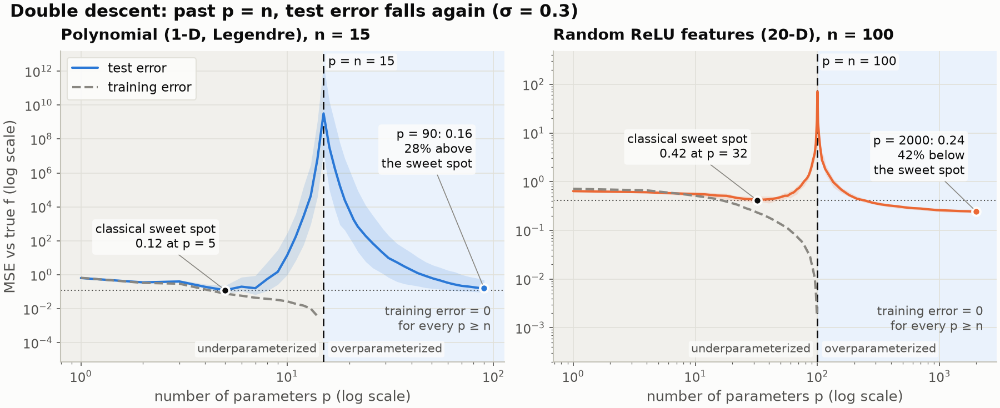

# double_descent_101

A hands-on demolition of the most sacred rule in data science, the bias-variance tradeoff, built from scratch on CPU.

Every course draws test error against model complexity as a U: too simple underfits, too complex overfits, pick the middle. This repository keeps adding parameters past the point where the model fits every noisy training point, and measures what the U leaves out. Test error **spikes** exactly where the number of parameters equals the number of training points, then **falls again**, with training error pinned at zero. In 20 dimensions it ends up 42% below the classical sweet spot.

No GPU and no deep learning framework are needed for the main result: minimum-norm least squares on polynomial and random features, on synthetic data with a known true function, runs in seconds on two CPU cores. A tiny trained network (optional, PyTorch CPU) confirms the same shape.



## Results at a glance

All numbers are medians over independent training draws at label noise 0.3, measured against the noiseless truth, and asserted or recorded by the code (`outputs/data/*.json`).

| | 1-D polynomials (n = 15) | 20-D random ReLU features (n = 100) |
|---|---|---|
| Classical sweet spot (best p < n) | 0.124 at p = 5 | 0.417 at p = 32 |
| Interpolation peak | 3.2e9 at p = 15 = n | 71 at p = 100 = n |
| Far past the threshold | 0.159 at p = 90 (training error 0) | **0.243 at p = 2000** (training error 0) |
| Second descent beats the sweet spot? | no, 28% above | **yes, 42% below** |

More findings, one per notebook:

- **The peak is made of noise.** Without label noise the polynomial peak disappears. For random features it grows from 30 to 81 as noise goes from 0 to 0.5. The design matrix is nearly singular at p = n: its smallest singular value drops from 0.67 to 0.012 and recovers to 0.95 at 2n.
- **Variance, not bias, drives the second descent.** Bias² falls and then stays flat at about 0.10. Variance spikes at p = n and collapses to 0.14 at p = 2000.
- **Benign overfitting.** The 2,000-feature model memorises every noisy label, and its memorised noise contributes only 0.064 to test error, less than the noise variance of 0.09. It beats the sweet spot at every noise level tried (51%, 51%, 42%, 27%).
- **Which interpolant matters.** With unscaled Legendre features the overparameterized polynomial collapses to 0.54, near the always-zero predictor. Scaling high orders down gives 0.16 from the same data.
- **More data can hurt.** With 100 features fixed, growing the training set from 30 to 100 points makes test error about 110 times worse.
- **Ridge flattens the peak.** A penalty of 0.01 per point removes it, and λ = 1 reaches 0.160, below the ridgeless floor.
- **Trained networks show it too.** A one-hidden-layer ReLU network trained with Adam peaks just past p = n (0.96 at 111 parameters) and descends to 0.24 at 2,993 parameters.

## Notebooks

| Notebook | Claim | Runtime (2 CPU) |
|---|---|---|
| [01 · The classical U](notebooks/01_the_classical_u.ipynb) | Below the threshold the textbook U is real: bias falls, variance rises | ~55 s |
| [02 · The interpolation peak](notebooks/02_the_interpolation_peak.ipynb) | Test error peaks exactly at p = n, and the peak grows with noise | ~35 s |
| [03 · The second descent](notebooks/03_the_second_descent.ipynb) | Past p = n error falls again with zero training error; in 20-D it beats the sweet spot | ~1.8 min |
| [04 · Benign overfitting](notebooks/04_benign_overfitting.ipynb) | Zero training error on noisy labels, better test error | ~40 s |
| [05 · More data can hurt](notebooks/05_more_data_can_hurt.ipynb) | At fixed capacity, adding data walks into the peak | ~1 min |
| [06 · What it means for you](notebooks/06_what_it_means_for_you.ipynb) | The U is regime-dependent; ridge flattens the peak; a trained MLP agrees | ~2.5 min |

Each notebook saves its figures to `outputs/figures/` (18 PNGs in total) and, for every figure, a JSON file in `outputs/data/` with its title, caption and the plotted numbers, plus a `NN_summary.json` with the settings, key results and takeaways.

The article draft built from these results is [overfitting_is_only_half_the_curve.md](overfitting_is_only_half_the_curve.md).

## Quick start

```bash
make setup       # install uv if needed, sync all extras (incl. CPU PyTorch), register the Jupyter kernel
make test        # 76 tests, about 30 seconds
make notebooks   # execute all six notebooks in place, about 7.5 minutes
make run         # Streamlit app on http://localhost:8501
make ci          # locked sync + read-only lint + type check + tests
```

`make help` lists every target. Python 3.11+ and [uv](https://docs.astral.sh/uv/) are the only prerequisites; the project runs in a 2-CPU, 8 GB GitHub Codespace.

## How it works

Two tracks, each with a known true function and Gaussian label noise:

| Track | Inputs | True function | Features | Parameters p |
|---|---|---|---|---|
| Polynomial | x ~ U[-1, 1] | sin(πx) + 0.5 cos(2πx) | Legendre polynomials, P_k scaled by √(2k+1)/(1+k) | degree + 1 |
| Random features | x ~ N(0, I₂₀) | tanh(2⟨β, x⟩) | max(0, w·x + b), w and b random and frozen | number of features |

Every model is fitted by **minimum-norm least squares** (`src/models/min_norm.py`, an SVD with a machine-precision cutoff). Below p = n that is ordinary least squares. Above it, among the infinitely many exact fits it returns the one with the smallest coefficients, which is the whole reason the second descent happens. The 1-D track can be drawn. The 20-D track is where interpolation turns benign: in one dimension, forcing a curve through noisy points is at best "tempered" overfitting.

The Streamlit app has four tabs: a capacity slider over the test-error curve, the fitted polynomial at any size, a noise dial, and the "more data hurts" sweep.

## Repository layout

```
config/settings.yaml     every experiment number (tasks, grids, seeds, draws, ridge, MLP)
src/
  config.py              typed settings (pydantic-settings; DD_<SECTION>__<KEY> env overrides)
  datasets/synthetic.py  tasks with a known truth: 1-D functions and the 20-D tanh ridge
  models/                Legendre and random ReLU features, min-norm and ridge solvers, tiny MLP
  theory/                interpolation threshold, singular values, bias-variance and signal/noise splits
  evaluation/            capacity sweep, data sweep, error surface, aggregation and curve summaries
  visualisation.py       matplotlib figures and plotly charts in one validated palette
  reporting.py           PNG + JSON publishing for every figure
app/streamlit_app.py     interactive companion
tests/                   the asserted claims (U, peak at p = n, second descent, min-norm) and more
notebooks/               01-06, committed with outputs
outputs/figures/         18 PNG figures
outputs/data/            JSON data and captions for every figure, one summary per notebook
```

## Related projects

Other from-scratch, CPU-only projects in the same series:

- [regularization_101](https://github.com/Dima806/regularization_101): the classical fix for overfitting, from an overfitting polynomial to Ridge, Lasso, ElasticNet and early stopping. Here ridge is what flattens the interpolation peak.
- [curse_of_dimensionality_101](https://github.com/Dima806/curse_of_dimensionality_101): why distance stops meaning anything as dimensions grow, the high-dimensional geometry where benign overfitting lives.
- [cv_arena](https://github.com/Dima806/cv_arena): the five ways cross-validation silently inflates your performance estimate, relevant because test error is hardest to estimate near the threshold.
- [kernels_101](https://github.com/Dima806/kernels_101): the kernel trick from scratch. Wide random-feature models approximate kernel methods, and min-norm interpolation becomes ridgeless kernel regression.
- [ensembles_101](https://github.com/Dima806/ensembles_101): bagging, random forests, boosting and stacking, the classical tools for trading bias against variance.
- [backprop_101](https://github.com/Dima806/backprop_101): the algorithm that trains every neural network, built without a framework, the machinery behind the tiny MLP here.
- [transformers_101](https://github.com/Dima806/transformers_101): the architecture behind large language models, the heavily overparameterized models double descent helps explain.

## References

- Belkin, Hsu, Ma, Mandal (2019). Reconciling modern machine-learning practice and the classical bias-variance trade-off. *PNAS*.
- Nakkiran, Kaplun, Bansal, Yang, Barak, Sutskever (2020). Deep double descent: where bigger models and more data hurt. *ICLR*.
- Geman, Bienenstock, Doursat (1992). Neural networks and the bias/variance dilemma. *Neural Computation*.
- Zhang, Bengio, Hardt, Recht, Vinyals (2017). Understanding deep learning requires rethinking generalization. *ICLR*.
- Bartlett, Long, Lugosi, Tsigler (2020). Benign overfitting in linear regression. *PNAS*.
- Hastie, Montanari, Rosset, Tibshirani (2022). Surprises in high-dimensional ridgeless least squares interpolation. *Annals of Statistics*.
- Nakkiran, Venkat, Kakade, Ma (2021). Optimal regularization can mitigate double descent. *ICLR*.
- Mallinar, Simon, Abedsoltan, Pandit, Belkin, Nakkiran (2022). Benign, tempered, or catastrophic: toward a refined taxonomy of overfitting. *NeurIPS*.

## License

Apache-2.0, see [LICENSE](LICENSE).
